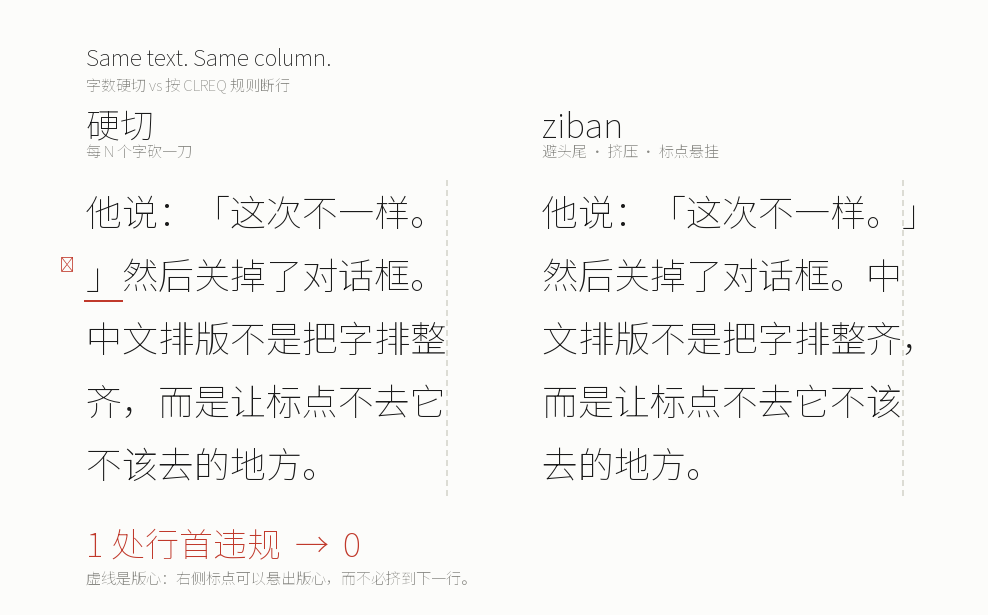

# ziban

**Correct CJK line breaking for everything that is not a browser.**

[中文说明 →](README.zh-CN.md)

Browsers got `text-spacing-trim`, `line-break: strict` and proper kinsoku years
ago. Everything else — Pillow, ReportLab, SVG, ffmpeg subtitles, `python-pptx`,
canvas — still reimplements it badly, because there is nothing to ask.

`ziban` is that thing: a pure-Python typesetting engine that turns a string and
a box into lines a Chinese typesetter would accept — and tells you, in machine
readable form, every time it had to compromise.



## The problem, in eight seconds

Naive `if len(s) > N: cut()`:

```
他说：「这次不一样。
」然后关掉了对话框。
```

`ziban`:

```
他说：「这次不一样。」
然后关掉了对话框。
```

The first version starts a line with `」`. That is not a matter of taste:
[《中文排版需求》(CLREQ)](https://www.w3.org/TR/clreq/) forbids closing
punctuation at line start (避头) and opening punctuation at line end (避尾).
Every renderer that is not a browser quietly breaks that rule — and the
punctuation it breaks is exactly the punctuation readers notice.

The image above is generated, not drawn by hand:
`python examples/compare.py --font <path-to-a-CJK-font>`. Re-run it after any
change to the rules and you will see immediately whether the typography got
better or worse.

## Install

[](https://pypi.org/project/ziban/)

```bash
pip install ziban              # core, zero dependencies
pip install "ziban[pillow]"    # + measuring with real font files
```

Published at <https://pypi.org/project/ziban/>.

Python 3.9+. No browser, no native build, no ICU, no model.

## Use it

### As a CLI

```console
$ echo "这是一个比较长的段落，用来看断行在真实文本上的表现。" \
    | ziban wrap - --width-em 8 --ruler
      +----------------+
  1   | 这是一个比较长的 |   8.0em
  2   | 段落，用来看断行 |   8.0em
  3   | 在真实文本上的表 |   8.0em
  4   | 现。             |   2.0em

4 line(s), box 8.0em, no diagnostics
```

`> ` in the gutter means the line ends with a hanging mark, `<` means a
compressed one, `!` means it overflowed. `--json` gives you the same thing
as structured data, for scripts and agents.

### As a library

```python
from ziban import Style, layout, EmMetrics

page = layout(
    "他说：「这次不一样。」然后关掉了对话框。",
    width=10 * 32,                     # 10 characters wide
    style=Style(size=32, leading=1.7),
    metrics=EmMetrics(32),             # or PillowMetrics("NotoSerifSC.otf", 32)
)

for line in page.lines:
    print(line.text, line.width)

page.diagnostics
# [Diagnostic(code='ORPHAN_LINE', line=1, ...)]
```

Every line carries its own explanation:

```python
line.adjustments   # (Adjustment(kind='hang', index=10, delta=32.0),)
line.slack         # pixels left over
line.overflow      # pixels past the box, 0 if it fits
line.justify_spacing
```

## What it does

| | |
|---|---|
| **避头尾 (kinsoku)** | closing marks never start a line, opening marks never end one |
| **标点挤压 (compression)** | a full-width mark is drawn at half width when that is what makes the line fit |
| **行末悬挂 (hanging)** | a mark may sit outside the margin rather than be pushed down — capped at one em *and* a quarter of the measure |
| **中西混排** | breaks between CJK and Latin, never inside a Latin word, numbers stay glued to their units |
| **硬断行** | `\n` is always honoured, blank lines survive |
| **诊断** | `OVERFLOW`, `NO_BREAK_OPPORTUNITY`, `KINSOKU_FALLBACK`, `ORPHAN_LINE` — with a suggested fix |
| **确定性** | same text + same font + same size → byte-identical output, on every platform |

## What it does not do

- No AI. No API keys. No "generate my copy".
- No browser, no headless Chromium, no layout engine to install.
- No GUI editor.
- No auto-publishing to any platform.
- **No bundled fonts.** Microsoft YaHei and PingFang are not redistributable;
  bring your own, or use Noto Sans SC / Noto Serif SC (OFL).

Being explicit about the last one is not pedantry: a library that ships a
proprietary font is a library companies cannot use.

## Rules are data, not `if`-statements

The whole policy lives in [`src/ziban/data/clreq.toml`](src/ziban/data/clreq.toml):

```toml
[kinsoku]
head_forbidden = "　，、。．；：？！）〕〉》」』】”’｝…"
tail_forbidden = "（〔〈《「『【“‘｛"

[compress]
compressed_ratio = 0.5
chars = "，、。．；：？！）〕〉》」』】”’…"

[hang]
max_ratio = 1.0
max_share = 0.25
```

Change the file to change the behaviour. A Japanese ruleset is a second TOML,
not a second engine. This is also why contributing is cheap: most typographic
bugs are one line of data.

## How it compares

| | kinsoku | compression | hanging | works outside a browser | deterministic |
|---|---|---|---|---|---|
| [heti](https://github.com/sivan/heti) | via browser | partial | ✗ | ✗ | ✗ |
| [pangu.py](https://github.com/vinta/pangu.py) | ✗ | ✗ | ✗ | ✓ | ✓ |
| [budoux](https://github.com/google/budoux) | ✗ | ✗ | ✗ | ✓ | ✓ |
| browser `text-spacing-trim` | ✓ | ✓ | partial | ✗ | ✓ |
| **ziban** | ✓ | ✓ | ✓ | ✓ | ✓ |

`budoux` decides *where* a break is semantically acceptable; `ziban` decides
whether the break is typographically legal. They compose.

## Status

`0.1.0` — published on PyPI. Engine complete for horizontal text; 958 tests
green (144 corpus × width combinations — 24 paragraphs × 6 measures — checked
against six invariants, plus golden cases).

Next:

- **0.2** font probing across Windows/macOS/Linux, pair compression (「。」 in
  one em), a Knuth–Plass-style cost function so the last line stops being an
  orphan
- **0.3** adapters: ReportLab, SVG, `python-pptx`; vertical text behind a flag
- **0.4** a `cards` example that renders real 1080×1440 image sets, and a
  `SKILL.md` wrapper so agents can call it

## License

MIT. See [LICENSE](LICENSE).

The ruleset follows [CLREQ](https://www.w3.org/TR/clreq/) (W3C). Character
classes follow a curated subset of [UAX #14](https://www.unicode.org/reports/tr14/).
